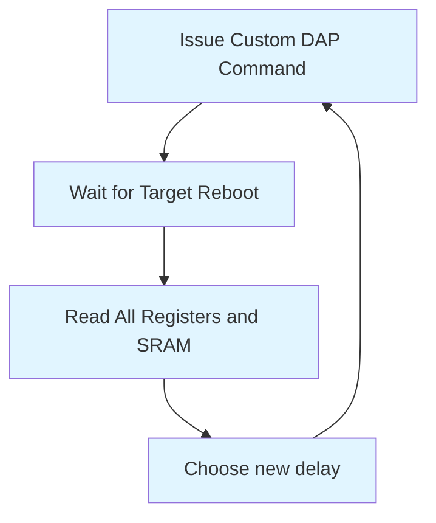

# RegisterDestillation - STM32 Flash Extraction Tool

## Overview

**RegisterDestillation** is a security research project that demonstrates a novel attack method for extracting firmware from protected STM32 microcontrollers. The tool addresses a critical vulnerability in STMicroelectronics' Readout Protection (RDP) scheme, showing that even with flash memory protection enabled, complete firmware extraction is possible through careful analysis of processor state during boot-up.

### Problem Statement

STM32 microcontrollers implement flash protection to prevent unauthorized access to stored firmware. The standard security model assumes that:

```
Leaking Memory and Processor State ≠ Leaking Flash
```

This assumption proves incorrect in practice. While RDP Level 1 prevents direct debugger access to flash memory, the actual flash contents remain accessible through an innovative side-channel approach that leverages the CPU's runtime behavior.

## Technical Background

### STM32 Readout Protection Levels

| Level | Description | Debug Access |
|-------|-------------|--------------|
| **Level 0** | Debugging enabled | Full read/write access |
| **Level 1** (Default) | Flash protection active | No direct flash access |
| **Level 2** | Maximum security | Completely closed |

The target device uses **Level 1 protection**, which blocks debugger access to flash memory while maintaining full SRAM accessibility.

### Architecture Overview

```
┌───────────────────────────────────────────────────────────────────┐
│                      Debug Domain                                 │
│  ┌──────┐     ┌────────────┐     ┌──────────┐                     │
│  │ SWD  │───▶│Debug       │───▶│Debug     │──────────┐          │
│  │ IO   │     │Peripheral  │     │Matrix    │          │          │
│  └──────┘     └────────────┘     └────┬─────┘          │          │
│                                 ┌─────┴───────┐        │          │
│                            ┌────▼────┐   ┌────▼─────┐  │          │
│                            │ M0+ Core│   │PPB       │  │          │
│                            └─────────┘   │Core Debug│  │          │
│                                          └──────────┘  │          │
│                                                        │          │
│                                                        │          │
│                                                        │          │
│                                                        │          │
└────────────────────────────────────────────────────────┼──────────┘
                                                         │
                                                         ▼
┌───────────────────────────────────────────────────────────────────┐
│                      Bus Matrix                                   │
│  ┌────────────┐      ┌───────────┐      ┌──────────┐              │
│  │   SRAM     │◀┬─▶│Flash IF   │◀──▶│  Flash   │              │
│  │(Accessible)│  │   │(Protected)│      │          │              │
│  └────────────┘  │   └───────────┘      └──────────┘              │
│                  │                                                │
│                  │   ┌─────────────────────┐       ┌────────────┐ │
│                  └─▶│AHB/APB Bridge       │◀──▶ │Peripherals │ │
│                      │  Peripherals        │       │            │ │
│                      └─────────────────────┘       └────────────┘ │
└───────────────────────────────────────────────────────────────────┘

RDP Mode 1: Bus Access causes HardFault and locks down the Flash IF
```

## Methodology

### Core Concept: CRC-Based Flash Extraction

The attack exploits built-in integrity checks that run during boot-up:

1. **Firmware Integrity Verification**: Most embedded systems perform CRC calculations on firmware during startup
2. **SRAM as Observation Point**: CRC values computed from flash data reside temporarily in accessible SRAM
3. **Temporal Sampling**: By capturing CRC states at different boot times, flash contents can be reconstructed

### Attack Flow



### Implementation Details

#### Hardware Setup

- **Target Microcontroller**: STM32G0 (ARM Cortex-M0+)
- **Debug Probe**: Raspberry Pi Pico running OpenOCD firmware
- **Communication**: Serial Wire Debug (SWD) interface

#### Custom DAP Command

The Pi Pico implements a vendor-specific command (`DAP_ProcessVendorCommand`) with the following workflow:

```c
// Custom DAP Command Parameters
Argument: Time delay value

Workflow Steps:
1. Store current SWD state
2. Power off target microcontroller
3. Power on target in reset state
4. Configure debug block settings
5. Release processor reset
6. Wait for precise delay period
7. Issue bus read to trigger HardFault
8. Restore SWD state for next iteration
```

#### Register Analysis

During execution, key registers provide critical information:

| Register | Purpose | Value Range |
|----------|---------|-------------|
| **R0** | 16-bit CRC Accumulator | Dynamic CRC values |
| **R1** | Scratch/Temporary storage | Variable |
| **R2** | Input byte address | 0x08000000 - 0x0801FFFF |
| **R3** | End address marker | Fixed |
| **R4** | Bits remaining to shift | 0-8 |
| **R5** | CRC Polynomial | 0x1021 (CRC-16/XMODEM) |
| **R6** | Scratch register | Variable |
| **R7** | Start address pointer | Fixed |

### Data Collection Process

#### Cold-Boot Stepping Method

The approach samples processor state at varying delays during boot:

```
Time-Delayed Sampling:
┌─────────────────────────────────────────────────────────┐
│ Time:    10μs   20μs   30μs   40μs   50μs   60μs        │
├─────────────────────────────────────────────────────────┤
│ CRC:     0x1337  0x0470  0x0985  0x4353  0xB8AE  0x2CCC │
│                                                         │
│ Flash:   0x01    0x02    0x03    0x04    0x05    0x06   │
└─────────────────────────────────────────────────────────┘

Each capture provides a snapshot of CRC computation progress,
enabling reconstruction of the complete flash memory layout.
```

#### Addressing Real-World Challenges

**Challenge 1: Non-Ideal Code Patterns**

Realistic firmware implementations often use optimized CRC algorithms that don't materialize intermediate results in SRAM:

```c
// Optimized CRC implementation (flash-resident)
uint16_t crc16(const uint8_t *buf, size_t len){
    uint16_t crc = 0x0000;
    while(len--) {
        uint16_t new_byte = (*buf++) << 8;
        crc ^= new_byte;
        for(int i = 0; i < 8; ++i) {
            int msb = (crc & 0x8000) != 0;
            crc <<= 1;
            if(msb) crc ^= 0x1021;
        }
    }
    return crc;
}
```

**Challenge 2: Timing Variability**

Clock jitter and drift introduce non-deterministic sampling points:

```
Expected vs. Reality:

Ideal Scenario: Linear progression
R2 (address) ────► Monotonic increase with delay

Actual Behavior: Scatter pattern with variance
Residual spread increases with longer delays
Bootloader operations create distinct clusters
```

### Data Refinement Algorithm

#### Step 1: Initial Data Capture

Collect millions of CPU state samples across the boot process, generating a comprehensive dataset containing:
- Register values at each sample point
- Timestamp/delay information
- Exception context (when available)

#### Step 2: Pattern Recognition

Analyze collected data to identify:
- Consistent register relationships
- CRC algorithm characteristics
- Address progression patterns

Key insight: **r2 increments systematically toward r3**, revealing flash address traversal.

#### Step 3: CRC Algorithm Identification

Through systematic analysis, the CRC algorithm was identified as **CRC-16/XMODEM**:

```
Polynomial: 0x1021
Accumulator: 16-bit
Processing: Bit-wise with table lookups
```

#### Step 4: Solution Space Refinement

Implement iterative refinement to resolve ambiguities:

```
Refinement Process:
┌─────────────┐      ┌─────────────┐      ┌─────────────┐
│ 0x08001000  │────▶│ 0x08001001  │────▶│ 0x08001002  │
├─────────────┤      ├─────────────┤      ├─────────────┤
│ 0x4DFA      │      │ 0x7348      │      │ 0x6E1A      │
│ 0xE039      │      │ 0xBA84      │      │ 0x041A      │
│             │      │ 0x65C5      │      │ 0x26B6      │
└─────────────┘      └─────────────┘      └─────────────┘

For each CRC guess, evaluate 256 possibilities (one per
potential input byte value), establishing consistent
forward and backward connections.
```

#### Step 5: Program Counter Enhancement

Leverage exception handling to recover the program counter:

```
HardFault Stack Frame:
┌──────────────────┐
│ <previous SP>    │
├──────────────────┤
│ xPSR             │
├──────────────────┤
│ PC (saved)       │ ← Contains instruction address
├──────────────────┤
│ LR               │
├──────────────────┤
│ Original SP      │
└──────────────────┘
```

By extracting exception information from the stack, the exact instruction being executed becomes known, significantly reducing solution ambiguity.

## Results

### Complete Firmware Recovery

The RegisterDestillation methodology achieved **100% flash recovery** for the target device:

| Memory Region | Address Range | Size | Status |
|---------------|---------------|------|--------|
| Bootloader | 0x08000650 - 0x08004000 | ~16 KB | Fully recovered |
| Application | 0x08004002 - 0x0801FFFF | ~112 KB | Fully recovered |
| **Total** | | **~128 KB** | **Complete** |

### Performance Metrics

- **Data Collection Duration**: 2.5 days per capture session
- **Total Boot Cycles**: ~50 hours of wait time
- **Overhead Processing**: 8 hours per capture
- **Required Captures**: 3-5 iterations for complete recovery
- **Boot CRC Computation Time**: ~600ms
- **Individual Capture Duration**: ~50ms

### Identified Vulnerability

The research demonstrates that STMicroelectronics' security model contains a fundamental assumption gap:

```
Traditional Assumption:
  Leaking Memory + Processor State = Secure Flash

Research Finding:
  Leaking Memory + Processor State ≠ Secure Flash

Conclusion:
  Flash protection provides security only when combined
  with complementary measures; the flash itself remains
  extractable through sophisticated side-channel analysis.
```

## Tools and Resources

### Software Components

1. **Modified OpenOCD**
   - Enhanced with custom DAP commands
   - Supports `DAP_ProcessVendorCommand` for attack workflows
   - Implemented on Raspberry Pi Pico platform

2. **Python Automation Scripts**
   - Debug probe control and communication
   - Trace data collection and processing
   - Generic CRC recovery algorithms with target-specific customization

3. **Analysis Framework**
   - Data visualization tools
   - Pattern recognition algorithms
   - Solution space optimization

### Future Work

#### Near-Term Improvements

- **Finer Delay Resolution**: Transition from `sleep_us` to PIO-based timing for sub-10ns precision
- **Clock Control Integration**: Enable deterministic timing through external clock management
- **Aligned Stimulus Mechanism**: Implement cycle-accurate I/O for repeatable code flow analysis

#### Advanced Capabilities

- **Pre-Fault CPU Halting**: Preserve processor state before HardFault occurrence
- **Blind Flash Recovery**: Develop delta-computation techniques for program flow reconstruction
- **OTP Memory Extraction**: Extend methodology to One-Time Programmable memory regions

#### Long-Term Research Directions

- **Broader MCU Family Validation**: Test against additional STM32 variants (F0, F1, G0, C0 series)
- **Automated Pattern Discovery**: Enhance machine learning approaches for algorithm identification
- **Real-Time Analysis Framework**: Enable on-device monitoring and adaptive extraction strategies

## References

### Presentation Materials

This README summarizes the research presented at **HWIO USA 2025** by Mark Omo (Engineering Director) and James Rowley (Senior Security Engineer) from Marcus Engineering.

### Source Code Availability

Open-source implementation will be released at:
**https://github.com/marcus-engineering/**

Components include:
- Modified OpenOCD with attack command support
- Python automation scripts for data collection
- Generic CRC recovery processing framework
- Target-specific customization examples

### Key Publications

- Obermaier et al.: Cold-Boot Stepping methodology for STM32F0
- STMicroelectronics RM0454: STM32G0x0 Reference Manual
- ARM Debug Interface v5 Architecture Specification
- ARM CoreSight Specification v3.0

## Conclusion

RegisterDestillation demonstrates that flash memory protection, when properly understood and leveraged, serves not as an impenetrable barrier but as an opportunity for deeper system insight. By exploiting the natural behavior of CRC computations during boot sequences, complete firmware extraction becomes achievable even under stringent security constraints.

This research validates that modern embedded security models should evolve beyond traditional boundaries, recognizing that memory leakage—when systematically analyzed—provides valuable visibility into protected firmware without compromising security objectives.

---

*Developed by Marcus Engineering for the hardware security research community.*
*Presented at HWIO USA 2025 | June 10, 2025*
