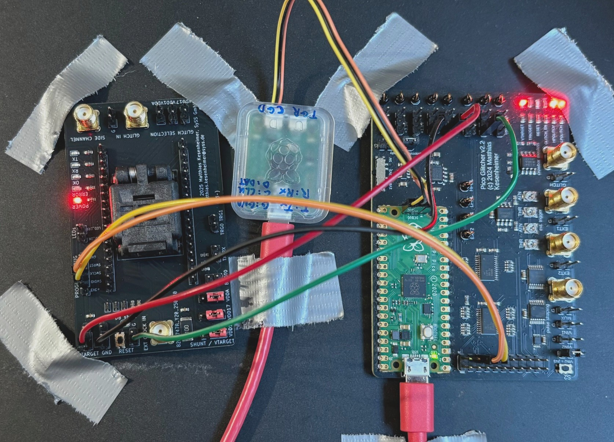

# RegisterDestiallation - STM32 Flash Extraction Tool

Extract firmware from protected STM32 microcontrollers using side-channel analysis of CRC computations during boot.

## Quick Start

```bash
# Initialize (requires git submodule for findus library)
git clone --recursive <this-git-repository>.git
cd RegisterDestillation

# Build debugprobe (Pico-based SWD debugger)
cd debugprobe && mkdir build && cd build
cmake .. && make

# bring the Raspberry Pico into BOOTSEL mode, then
picotool load debugprobe.bin && picotool reboot

# Run attack
cd ..
python pico-glitcher-reg-destillation.py --rpico /dev/ttyACM0 --delay 0 1_000_000

# Analyze the recorded data (choose whatever register you want to check)
analyzer --directory databases -x delay -y dummy
analyzer --directory databases --x-range 0x08000000 0x08010000 -x r3 -y r1
```

## Hardware Setup



## How It Works

STM32 microcontrollers with Readout Protection (RDP Level 1) block direct flash access via debug interfaces. RegisterDestillation exploits this by:

1. **Cold-boot stepping**: Power-cycles the target while injecting precise timing delays (microsecond precision)
2. **State sampling**: Captures registers and SRAM at varying boot points before HardFault triggers
3. **CRC reconstruction**: Uses CRC values computed from flash data to reconstruct the complete firmware image

## Usage

### Basic Execution

```bash
# Full delay sweep (0 to 1,000,000 microseconds)
python pico-glitcher-reg-destillation.py --rpico /dev/ttyACM0 --delay 0 1_000_000

# Specific delay point
python pico-glitcher-reg-destillation.py --rpico /dev/ttyACM0 --delay 50000 50000
```

### Sample Output

```
[+] Version of Pico Glitcher: [1, 13, 1]
[+] Experiment 0        0       (NA)    57122   G       b'success' 
        0x00000005 0x00000001 0x00000001 0x000000d2
        0x20000020 0xffffffff 0xffffffff 0xffffffff
        0x00000001 0x20001ff0 0x08000255 0x0800023c
        ...
```

## Data preparation

```bash
database-tool --dbname databases/pico-glitcher-reg-destillation.py_20260421_144342.sqlite --export capture_20260421_144342-r3-r1.csv --columns r3 r1
python sort_csv.py -o capture_20260421_144342-r3-r1-sorted.csv capture_20260421_144342-r3-r1.csv
cat capture_20260421_144342-r3-r1-sorted.csv | uniq > capture_20260421_144342-r3-r1-uniq.csv
python hex_to_binary.py --flat -o capture_20260421_144342-r3-r1-uniq.bin capture_20260421_144342-r3-r1-uniq.hex
```

## Installation

See [INSTALL.md](./INSTALL.md) for detailed setup instructions including:
- Pico SDK configuration
- findus Python library installation
- Environment variables

## Ghidra MCP server

See [GhidraMCP](https://github.com/LaurieWired/GhidraMCP) for more details.

- download the ghidra plugin from [releases](https://github.com/LaurieWired/GhidraMCP/releases)
- extract the archive and install the plugin
- Add this to `~/.claude.json`:

```json
"mcpServers": {
  "ghidra": {
    "command": "python",
    "args": [
      "/home/$USER/tools/GhidraMCP/bridge_mcp_ghidra.py",
      "--ghidra-server",
      "http://localhost:8080/"
    ]
  }
},
```

- Before you start claude, install the dependencies and activate the virtual environment

```bash
cd 
python -m venv ghidra-mcp-venv
pip install -r requirements.txt
source ~/tools/GhidraMCP/ghidra-mcp-venv/bin/activate
```

## Resources

- **Technical Details**: [DETAILS.md](./DETAILS.md)
- **Installation Guide**: [INSTALL.md](./INSTALL.md)
